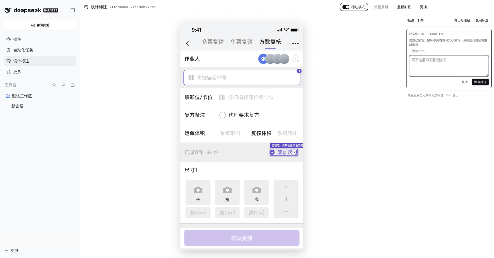
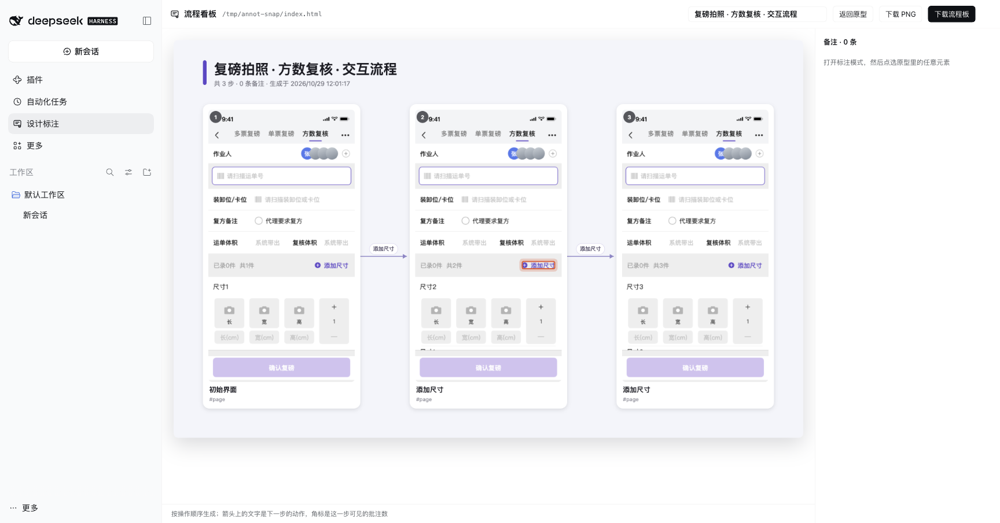
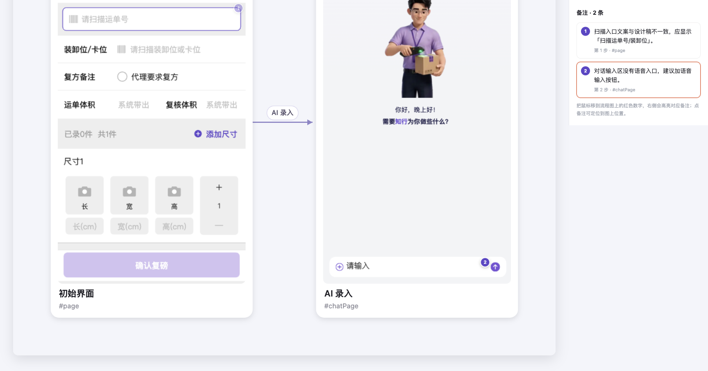
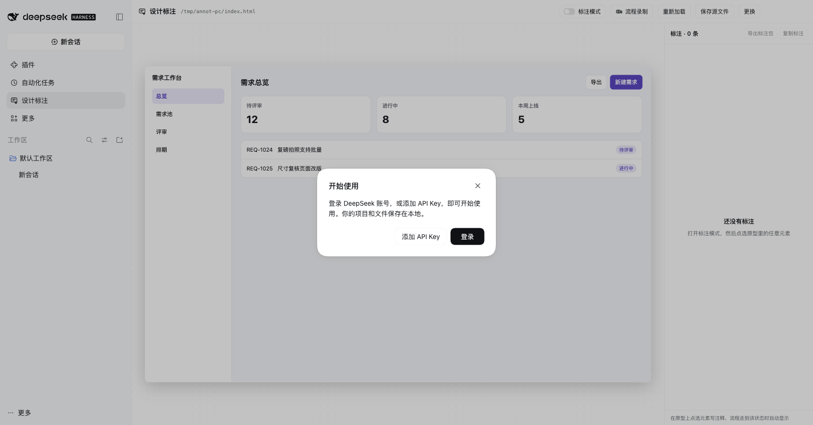

# 设计标注 · Design Annotation for DeepSeek Harness

给 HTML 原型加**标注**和**流程录制**的 DeepSeek Harness 插件。

打开一个原型 → 点选元素写注释 → 流程走到对应状态时注释自动出现 → 一键导出可分享的标注包或带批注的流程图。

> 不修改原型文件：所有标注写在原型旁边的 sidecar JSON 里。

## 特性

- **选中即锚定**：点哪个元素就标哪个，记录稳定选择器、文本快照与位置。
- **跟着界面状态出现**：标注时自动采集当前浮层状态（`aria-hidden`、`is-open` 之类的状态类、`display`），之后只有回到那个状态才显示，不会在所有页面上一股脑铺满。
- **标注模式常开**：可以连着标多个元素，点中的位置会锁定，鼠标移到右侧写备注不会跑；`Shift` 轻按开关，`Ctrl/⌘ + Enter` 保存。
- **零安装分发**：导出 `.annotated.html`，原型 + 标注合成一个文件，对方双击就能看，不需要装插件。
- **保存源文件**：把原型 + 标注存成可再次打开的副本，下次直接选它继续编辑。
- **流程录制**：正常操作原型，每次点击**立刻冻结一帧**，结束后自动排成带箭头、动作标签和触发位置的流程图，可导出 PNG 或可交互的 HTML。
- **画板自适应**：自动识别 App / PDA 原型与 PC 原型，画板尺寸随之切换。

## 截图

| 标注面板 | 流程看板 |
| --- | --- |
|  |  |

| 导出的交互式流程板 | PC 原型画板 |
| --- | --- |
|  |  |

## 环境要求

- DeepSeek Harness **桌面端 0.2.x**
- 已在 macOS 上验证；Windows / Linux 的文件选择与保存对话框使用 PowerShell / zenity 实现

## 安装

1. 下载本仓库（`git clone` 或下载 ZIP 后解压）。
2. 打开 DeepSeek Harness → **设置 → 插件 → 添加插件**，粘贴**解压后这一层**的绝对路径（里面有 `package.json` 的那一层，例如 `~/dsh-plugins/dsh-design-annotate`）。
3. 完全退出 Harness 再打开，左侧出现「设计标注」。

没有 npm 依赖、没有构建步骤；`bridge.js` 与 `export-viewer.js` 由 Host 按相对路径读取，整个目录搬到哪都能用。

## 使用

### 标注

1. 侧边栏点「设计标注」。
2. 点「打开原型」（或已打开时的「更换」）→ 弹出系统文件选择器，选一个本地 HTML；系统对话框不可用时可回退到手动输入路径 / 扫描目录。
3. 打开「标注模式」，点原型里任意元素 → 右侧写注释 → 「保存标注」。
4. 原型照常点，流程走到该状态时，元素右上角出现编号 pin；右侧列表点条目可跳转定位。

标注模式会一直保持开启：再点一次「标注模式」或按 `Esc` 才关闭。

### 快捷键

| 快捷键 | 作用 |
| --- | --- |
| `Ctrl/⌘ + Enter` | 保存当前标注 |
| `Shift`（轻按一下） | 开 / 关标注模式 |
| `Esc` | 退出标注模式 |

在备注输入框里按 `Shift` 打大写字母不会切换模式。

### 流程录制

1. 点顶部「📹 流程录制」。
2. 在原型里正常操作，每次点击都会截取当前页面；没有点击的等待状态点「插入步骤」补一帧。
3. 点「结束生成」，进入流程看板。

看板里鼠标移到某一步的卡片上，会在缩略图里用红色闪烁框标出这一步的**触发位置**；右上角可直接改流程名称。

- 「下载 PNG」：流程图 + 右侧静态备注栏，一张长图。
- 「下载流程板」：单文件 HTML，左边流程图、右边备注栏，鼠标移到数字上会高亮对应备注（其余编号淡出 40%），可双击打开。

### 导出与保存

- **导出标注包**：生成只读的 `<原型名>.annotated.html`，对方双击即可查看（无需插件）。
- **保存源文件**：生成可再次打开的副本；在这个文件上继续标注会写入它旁边的 `.annotations.json`。

## 数据存储

标注默认写在原型旁边：

```
index.html
index.html.annotations.json   # 标注数据
```

```json
{
  "version": 1,
  "file": "/abs/path/index.html",
  "annotations": [
    {
      "id": "a-...",
      "selector": "#chatInput",
      "page": "#chatPage",
      "note": "对话输入区没有语音入口",
      "status": "open",
      "conditions": [
        { "selector": "#chatPage", "sig": { "ariaHidden": "false", "cls": ["is-open"], "display": "flex" } }
      ],
      "snapshot": { "tag": "input", "text": "请输入", "rect": { "x": 12, "y": 820, "w": 359, "h": 28 } }
    }
  ]
}
```

- `selector`：`id` > 唯一 `data-*` > DOM 路径；失配时用 `snapshot` 辨认与人工重挂。
- `conditions`：出现条件，全部成立才显示。
- `status`：`open` / `resolved`。

`保存源文件` 生成的副本会把标注以 `window.__DSH_ANNOTATE_DATA__` 内联在 HTML 里；再次打开时自动读回，编辑后写入同目录 sidecar。

## 画板自适应

| 原型 | 判定 | 画板 |
| --- | --- | --- |
| App / PDA | `<meta name="viewport" content="width=480">`，宽度 280–700 | 按声明宽度，高度取渲染后的内容高度 |
| PC / Web | 无以上声明 | 1280×800，等比缩放到面板内 |

## 已知限制

- 标注只支持 `.html` / `.htm` 单文件原型（或资源内联的自包含原型）；多页面目录的相对跳转尚未做路由映射。
- 流程录制的冻结帧是**静态 DOM**（不执行脚本）：自包含原型几乎无损；依赖外部相对资源或 canvas 运行时结果的页面可能缺失部分内容。
- 元素选择器依附 DOM 结构，原型大改后需要重新标注。
- 流程看板目前不持久化，关闭面板后需要重新录制。

## 目录结构

```
.
├── package.json          # DSH bundle 清单（Host + Client 入口）
├── cordis.patch.yml      # 插件行定义与默认配置
├── index.js              # Host：/annotate-api 路由（serve / 标注读写 / 导出 / 保存 / 原生文件对话框）
├── client.js             # Client：侧边栏入口、标注面板、流程看板
├── bridge.js             # 注入原型的脚本：选元素、状态条件、pin、录制冻结帧
├── export-viewer.js      # 导出文件内联的只读查看器
├── vendor/html2canvas.min.js  # 录制光栅化（MIT，1.4.1）
├── locale/               # 插件元数据（中/英）
└── icon.svg
```

## License

[MIT](LICENSE)

`vendor/html2canvas.min.js` 为 [html2canvas](https://html2canvas.hertzen.com/) 1.4.1，遵循其 MIT 许可（文件头保留原始版权声明）。
